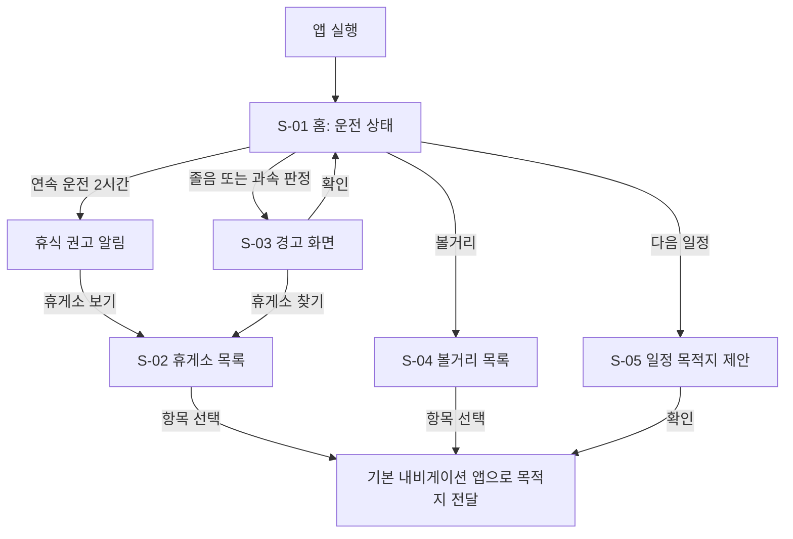

# GBSW 제품 요구사항 문서 (PRD)

> 2026-11-14: 아래 요구사항·초기 상태는 기획 기준으로 보존한다. 현재 구현 내용과 검증 결과, 제조사 권한 및 외부 서비스 제한은 [구현 현황](IMPLEMENTATION.md)을 참고한다.
> 같은 날 후속 요청으로 Figma 디자인의 실제 배치를 우선하도록 변경했다. 차량 런처 UI는 네이티브 Compose이며 운전 판정·조회 로직과 기존 CAL 화면은 유지한다.

## 00. 문서 관리 정보

| 항목 | 내용 |
|---|---|
| 문서명 | GBSW 제품 요구사항 문서 (PRD) |
| 제품명 | GBSW (가칭, 앱 표시명 `GBSW`) |
| 저장소 | `2026-Hyundai-Motor-Company/gbsw_main` |
| 버전 | 0.1 |
| 작성일 | 2026-11-09 |
| 작성자 | GBSW 팀 |
| 문서 상태 | 초안 (팀 검토 전) |
| 검토 및 승인 | 미검토. 팀원 2인 검토 후 승인 예정. 외부 승인자(멘토, 심사 주관 측) 여부는 확인 필요 |

### 변경 이력

| 버전 | 일자 | 변경 내용 | 작성자 |
|---|---|---|---|
| 0.1 | 2026-11-09 | 최초 작성. 아이디어 5종과 현재 구현 상태(커밋 `29b8633`) 기준 | GBSW 팀 |

### 이해관계자

| 구분 | 대상 | 역할 |
|---|---|---|
| 개발팀 | 팀원 2인 | 기획, 개발, 시연 전체 담당. Kotlin 경험 적음 |
| 최종 사용자 | 장거리 운전자 | 05장 참고 |
| 외부 검토자 | 확인 필요 | 저장소 조직명으로 보아 현대자동차 관련 프로그램 또는 대회로 추정되나 확인되지 않음. 심사 기준과 제출 조건 확인 필요 |

## 01. Executive Summary

**서비스 개요.** 차량 디스플레이(Android Automotive OS)에서 동작하는 운전 보조 앱이다. 장시간 운전, 졸음, 과속 같은 위험 상황을 감지해 경고하고, 휴식 장소와 경로 주변 볼거리를 안내하며, 캘린더 일정에 맞춰 목적지를 자동으로 설정한다.

**핵심 문제.** 장거리 운전자는 피로가 쌓여도 휴식 시점을 놓치기 쉽고, 졸음이나 과속을 스스로 인지하지 못하는 경우가 있다. 위험을 알리는 것만으로는 행동 변화로 이어지지 않으며, 쉴 곳을 바로 제시해야 실제 휴식으로 연결된다(가설, 검증 필요).

**목표 고객.** 고속도로 장거리 운전자, 여행 목적 운전자.

**핵심 가치 제안(제안).** 위험 경고와 휴식 장소 안내를 하나의 흐름으로 연결한다. 경고가 발생하면 가까운 휴게소를 즉시 제시한다.

**현재 개발 단계.** 프로젝트 골격 단계이다. Car App Library 기반 차량 앱 진입점과 MVVM 폴더 구조만 존재한다. 기획된 기능 5종은 모두 미구현이다. 현재 차량 화면에는 구조 확인용 임시 곡 목록이 표시된다.

**주요 의사결정 사항.**

| 구분 | 내용 | 상태 |
|---|---|---|
| 대상 플랫폼 | 차량 전용 | 확정. 단, Android Auto(휴대폰 연결) 포함 여부는 미정(14장 Q-01) |
| 아키텍처 | MVVM (View, Model, ViewModel, Service) | 확정 |
| 상태 관리 | StateFlow, DI 미사용 | 확정 |
| 제품 중심축 | 졸음·과속 방지를 중심으로 휴게소 안내를 해결책으로 연결 | 제안(14장 Q-02) |
| 계기판 조작, 카메라 기반 졸음 감지 | 제3자 앱에서의 구현 가능 여부 미확인 | 검토 중(14장 Q-03, Q-04) |

## 02. Background & Problem Definition

### 기획 배경

팀이 정의한 아이디어는 다음 5종이다.

1. 장시간 운전 시 휴게소 추천
2. 여행 중 근처 볼거리 안내
3. 졸음운전 감지 시 계기판 조작
4. 과속 또는 졸음운전 시 귀신 연출로 경고
5. 캘린더 연동 자동 내비게이션

### 사용자 문제와 발생 상황

| 문제 | 발생 상황 | 근거 구분 |
|---|---|---|
| 휴식 시점을 놓친다 | 목적지 도착을 우선해 쉬지 않고 연속 운전 | 가설 |
| 졸음을 스스로 인지하지 못한다 | 야간, 단조로운 고속도로 구간 | 가설 |
| 과속을 인지하지 못한다 | 교통량이 적은 구간 | 가설 |
| 경고를 받아도 쉴 곳을 찾기 번거롭다 | 운전 중 내비게이션 조작이 제한됨 | 가설 |
| 일정 장소를 매번 직접 입력해야 한다 | 캘린더에 장소가 있어도 내비게이션과 연동되지 않음 | 가설 |
| 여행 중 경로 주변 정보를 얻기 어렵다 | 운전 중 검색 불가 | 가설 |

### 기존 해결 방식의 한계

차량 기본 기능(운전자 주의 경고 등)과 내비게이션 앱(휴게소 안내 등)이 일부 기능을 제공하는 것으로 알려져 있으나, 이 문서 작성 시점에 기능 범위를 공식 자료로 확인하지 않았다. 03장의 비교표를 확인한 뒤 이 항목을 확정한다.

### 검증이 필요한 근거

- 장시간 연속 운전과 졸음운전 사고의 관계를 보여주는 공식 통계(도로교통공단, 한국도로공사 등). 출처 확인 필요.
- 경고 직후 휴게소를 제시하면 실제 휴식 비율이 높아지는지. 사용성 테스트로 검증 필요.

## 03. Market & Competitive Analysis

외부 시장 자료는 이 문서 작성 시점에 조사하지 않았다. 시장 규모, 점유율, 사용자 수는 기재하지 않는다.

### 목표 시장 및 사용자 집단

- Android Automotive OS를 탑재한 차량의 운전자
- 그중 고속도로 장거리 운전이 잦은 운전자, 여행 목적 운전자

Android Automotive OS 탑재 차량의 국내 보급 현황은 확인 필요.

### 비교 대상 후보

| 비교 대상 | 겹치는 기능(추정) | 확인 상태 |
|---|---|---|
| 차량 기본 운전자 주의 경고 기능 | 졸음·부주의 감지 및 경고 | 차종별 기능 범위 확인 필요 |
| 국내 내비게이션 앱 | 휴게소 안내, 경로 주변 장소 | 기능 범위 확인 필요 |
| Google 지도 등 해외 지도 앱 | 장소 검색, 캘린더 일정 장소 표시 | 기능 범위 확인 필요 |

### 차별점(제안)과 실현 가능성

| 차별점 | 실현 가능성 |
|---|---|
| 위험 경고와 휴게소 안내를 한 흐름으로 연결 | 높음. 운전 시간과 장소 데이터만으로 구현 가능 |
| 귀신 연출로 경고 체감도를 높임 | 중간. 템플릿 UI 제약과 안전성 검토 필요(09, 11장) |
| 캘린더 일정 기반 목적지 자동 설정 | 중간. 차량 OS에서 캘린더 접근 가능 여부 확인 필요 |
| 졸음 감지 시 계기판 조작 | 낮음 또는 불명. 제3자 앱의 계기판 제어 권한 확인 필요 |

## 04. Product Vision & Objectives

**제품 비전(제안).** 장거리 운전자가 위험한 상태로 운전을 이어가지 않도록, 위험을 알리고 휴식으로 이어지게 한다.

### 핵심 목표

1. 위험 운전 상태(장시간 연속 운전, 졸음, 과속)를 감지해 경고한다.
2. 경고 후 1회 조작 이내로 휴식 장소 안내에 도달하게 한다.
3. 운전 중 조작을 최소화한다(일정 기반 목적지 설정, 경로 주변 정보 자동 표시).

### 성공 기준 및 KPI

모든 목표치는 근거 자료가 없는 제안 목표이다. 출시 형태(시연, 사용자 테스트, 배포)가 정해지면 확정한다.

| KPI | 정의 | 측정 방법 | 목표치 |
|---|---|---|---|
| 경고 후 휴식 안내 도달률 | 경고 발생 건 중 휴게소 목록을 연 비율 | 앱 내 이벤트 로그 또는 테스트 관찰 기록 | 제안 목표 70% 이상 |
| 경고 후 휴식 장소 선택률 | 경고 발생 건 중 휴게소를 선택해 안내를 시작한 비율 | 앱 내 이벤트 로그 또는 테스트 관찰 기록 | 제안 목표 50% 이상 |
| 경고 인지 시간 | 경고 표시부터 사용자 반응(확인, 선택)까지 시간 | 사용성 테스트 측정 | 제안 목표 평균 3초 이내 |
| 시연 시나리오 성공률 | 정의된 시연 시나리오의 단계 중 오류 없이 완료한 비율 | 리허설 기록 | 제안 목표 100% |

## 05. Target Users & Use Cases

### 핵심 사용자

| 사용자 | 특성 | 해결 과제 |
|---|---|---|
| 장거리 운전자 | 출장, 귀성 등으로 2시간 이상 연속 운전 | 적절한 시점에 쉬고 싶다 |
| 여행 운전자 | 목적지까지 가는 과정도 여행으로 여김 | 경로 주변 볼거리를 알고 싶다 |
| 일정이 많은 운전자 | 하루에 여러 장소를 이동 | 목적지 입력 없이 다음 일정 장소로 가고 싶다 |

### 핵심 User Story

| ID | User Story |
|---|---|
| US-01 | 장거리 운전자로서, 오래 운전했을 때 가까운 휴게소를 추천받고 싶다. 쉴 시점을 놓치지 않기 위해서다. |
| US-02 | 운전자로서, 졸음이나 과속 상태일 때 확실히 알아챌 수 있는 경고를 받고 싶다. 사고를 피하기 위해서다. |
| US-03 | 운전자로서, 경고를 받은 직후 바로 쉴 곳을 안내받고 싶다. 운전 중 직접 검색할 수 없기 때문이다. |
| US-04 | 여행 운전자로서, 지나가는 경로 근처의 볼거리를 알고 싶다. 들를지 판단하기 위해서다. |
| US-05 | 일정이 많은 운전자로서, 다음 일정 장소로 안내가 자동으로 설정되길 원한다. 운전 전 입력을 줄이기 위해서다. |

### 대표 사용 시나리오

1. 사용자가 차량에서 앱을 실행하고 출발한다. 홈 화면에 연속 운전 시간이 표시된다.
2. 연속 운전 시간이 기준을 넘으면 휴게소 추천 알림이 표시된다.
3. 졸음 또는 과속이 감지되면 경고 화면이 표시되고, 경고 화면에서 가까운 휴게소 목록으로 이동할 수 있다.
4. 사용자가 휴게소를 선택하면 길안내가 시작된다.
5. 차량이 일정 시간 정차하면 휴식으로 간주해 연속 운전 시간을 초기화한다.

## 06. Product Scope

### 우선순위 정의

| 등급 | 의미 |
|---|---|
| P0 | MVP 필수. 없으면 핵심 흐름이 성립하지 않음 |
| P1 | MVP 포함 목표. 일정이 부족하면 후순위로 이동 가능 |
| P2 | 후속 버전 검토 |

우선순위는 팀 확정 전 제안안이다(14장 Q-02).

### MVP 포함

| 기능 | 우선순위 | 이유 |
|---|---|---|
| 운전 상태 표시(연속 운전 시간) | P0 | 모든 경고와 추천의 기준 데이터 |
| 장시간 운전 시 휴게소 추천 | P0 | 외부 하드웨어 없이 구현 가능한 핵심 가치 |
| 위험 운전 경고 화면 | P0 | 졸음·과속 대응의 사용자 접점 |
| 데모용 상태 시뮬레이션 | P0 | 에뮬레이터에서 졸음·과속을 재현할 수단이 없음 |
| 과속 감지 | P1 | 차량 속도 데이터 접근 가능 여부 확인 후 확정 |
| 귀신 연출 | P1 | 경고 화면 위에 덧붙이는 표현 방식 |
| 근처 볼거리 안내 | P1 | 휴게소 추천과 같은 장소 데이터 구조 재사용 |

### MVP 제외 및 후속 검토

| 기능 | 처리 | 이유 |
|---|---|---|
| 캘린더 연동 자동 내비게이션 | P2 | 차량 OS의 캘린더 접근 가능 여부 미확인 |
| 카메라 기반 졸음 감지 | P2 | 차량 카메라 접근 권한 미확인. MVP는 시뮬레이션으로 대체 |
| 졸음 감지 시 계기판 조작 | P2 | 제3자 앱의 계기판 제어 가능 여부 미확인 |
| 휴대폰 앱(`:mobile`) 화면 | 제외 | 차량 전용 결정 |
| 자체 턴바이턴 길안내 | 제외 | 기존 내비게이션 앱으로 목적지를 넘기는 방식으로 대체 |
| 사용자 계정, 서버 | 제외 | MVP 흐름에 필요하지 않음 |

## 07. Functional Requirements

구현 상태 기준일은 2026-11-09, 커밋 `29b8633`이다. 수치 기준(2시간, 10분 등)은 모두 제안값이며 Q-05에서 확정한다.

| ID | 기능명 | 요구사항 | 우선순위 | 구현 상태 | 수용 기준 |
|---|---|---|---|---|---|
| FR-001 | 차량 앱 실행 | 차량 런처에서 앱을 실행하면 홈 화면을 표시한다. | P0 | 일부 구현. 진입점(`CarAppActivity`, `MyCarAppService`)은 존재하고 빌드는 성공했으나 에뮬레이터 실행은 검증하지 않음. 현재 첫 화면은 임시 곡 목록 | Automotive 에뮬레이터에서 앱 아이콘을 누르면 3초 이내에 홈 화면이 표시된다. |
| FR-002 | 연속 운전 시간 측정 | 주행 시작 시점부터 연속 운전 시간을 측정한다. 차량이 10분 이상 정차하면 0으로 초기화한다. | P0 | 기획 확정·미구현 | 시뮬레이션으로 주행 30분을 진행하면 홈 화면에 30분이 표시된다. 10분 정차 후 0분으로 바뀐다. 9분 정차 후에는 유지된다. |
| FR-003 | 장시간 운전 알림 | 연속 운전 시간이 2시간에 도달하면 휴식 권고 알림을 표시한다. 사용자가 닫으면 30분 뒤 다시 표시한다. | P0 | 기획 확정·미구현 | 2시간 도달 시 1회 표시된다. 닫은 뒤 30분 이전에는 다시 표시되지 않고 30분 시점에 다시 표시된다. |
| FR-004 | 휴게소 추천 목록 | 현재 위치 기준 진행 방향의 가까운 휴게소를 거리순으로 표시한다. 각 항목에 이름과 거리를 표시한다. | P0 | 기획 확정·미구현 | 장소 데이터에서 거리순으로 정렬되어 표시된다. 결과가 없으면 "근처에 휴게소가 없습니다"를 표시한다. 위치를 얻지 못하면 오류 안내와 재시도 버튼을 표시한다. |
| FR-005 | 휴게소 길안내 시작 | 목록에서 휴게소를 선택하면 차량의 기본 내비게이션 앱에 목적지를 전달한다. | P0 | 검토 중. 전달 방식은 Q-06 | 선택 후 내비게이션 앱이 해당 좌표로 실행된다. 내비게이션 앱이 없으면 "길안내 앱을 찾을 수 없습니다"를 표시한다. |
| FR-006 | 졸음 상태 판정 | 졸음 상태를 판정한다. MVP는 시뮬레이션 입력으로 판정하고, 실제 감지 방식은 Q-03 결정을 따른다. | P0 | 기획 확정·미구현. 감지 방식 검토 중 | 시뮬레이션에서 졸음을 켜면 1초 이내에 졸음 상태로 바뀌고 FR-008이 실행된다. |
| FR-007 | 과속 판정 | 현재 속도가 기준 속도를 넘으면 과속으로 판정한다. 기준 속도는 Q-07에서 정한다. | P1 | 기획 확정·미구현 | 기준 100km/h 가정 시 시뮬레이션 101km/h에서 과속, 100km/h에서 정상으로 판정된다. 속도 데이터를 얻지 못하면 과속 판정을 중단하고 홈 화면에 "속도 정보 없음"을 표시한다. |
| FR-008 | 위험 운전 경고 | 졸음 또는 과속 판정 시 경고 화면을 표시한다. 경고 화면에서 "휴게소 찾기"와 "확인"을 제공한다. | P0 | 기획 확정·미구현 | 판정 1초 이내에 경고 화면이 표시된다. "휴게소 찾기"를 누르면 FR-004 목록으로 이동한다. "확인"을 누르면 이전 화면으로 돌아간다. 같은 원인의 경고는 확인 후 5분 이내에 반복되지 않는다. |
| FR-009 | 귀신 연출 | 경고 화면에 귀신 이미지와 경고음을 함께 표시한다. 연출 강도는 Q-08 결정을 따른다. | P1 | 기획 확정·미구현. 연출 방식 검토 중 | 경고 화면에 지정 이미지와 경고음이 함께 출력된다. 화면 전체 섬광, 갑작스러운 큰 소리는 사용하지 않는다. |
| FR-010 | 근처 볼거리 안내 | 주행 중 현재 위치 주변의 관광지를 목록으로 표시한다. 선택 시 FR-005와 같은 방식으로 길안내를 시작한다. | P1 | 기획 확정·미구현 | 위치 기준 반경 내 관광지가 거리순으로 표시된다. 결과가 없거나 오류가 나면 FR-004와 같은 안내를 표시한다. |
| FR-011 | 계기판 경고 표시 | 졸음 판정 시 계기판에 경고를 표시한다. | P2 | 검토 중. 구현 가능 여부 미확인 | Q-04 결정 후 작성한다. |
| FR-012 | 캘린더 일정 조회 | 기기 캘린더에서 오늘 일정 중 장소가 있는 다음 일정을 조회한다. | P2 | 기획 확정·미구현 | 권한 허용 시 다음 일정의 제목, 시간, 장소가 표시된다. 권한 거부 시 기능 비활성 안내를 표시한다. 장소 없는 일정만 있으면 "장소가 있는 일정이 없습니다"를 표시한다. |
| FR-013 | 일정 기반 자동 길안내 | 다음 일정 장소를 목적지로 제안하고, 사용자가 확인하면 길안내를 시작한다. | P2 | 기획 확정·미구현 | 앱 실행 시 다음 일정 장소가 제안된다. 확인 시 FR-005 방식으로 실행된다. 사용자 확인 없이 길안내를 시작하지 않는다. |
| FR-014 | 데모 시뮬레이션 | 개발·시연용으로 주행 시간, 속도, 졸음 상태를 수동으로 바꾸는 기능을 제공한다. 배포 빌드에서는 숨긴다. | P0 | 검토 중(제안 기능) | 디버그 빌드에서 각 값을 바꾸면 FR-002, FR-006, FR-007 결과가 즉시 반영된다. 릴리스 빌드에서는 진입 경로가 없다. |

## 08. User Flow & Screen Specification

### 전체 사용자 흐름

### 화면 목록

차량 앱은 Car App Library의 정해진 템플릿으로만 화면을 구성한다. 템플릿 후보는 라이브러리 버전에 따라 달라지므로 구현 시 확인한다.

| ID | 화면 | 목적 | 사용자 행동 | 시스템 응답 | 로딩·빈 화면·오류 | 구현 상태 |
|---|---|---|---|---|---|---|
| S-00 | 임시 곡 목록 | 구조 확인용 예시 | 곡 선택 | 제목 영역에 선택한 곡 이름 표시 | 해당 없음 | 구현됨. 제품 기능과 무관하며 S-01로 교체 예정 |
| S-01 | 홈 | 현재 운전 상태 확인 | 볼거리, 다음 일정 메뉴 선택 | 연속 운전 시간, 위험 상태 표시 | 속도 정보 없음 안내 | 미구현 |
| S-02 | 휴게소 목록 | 쉴 곳 선택 | 항목 선택 | 길안내 시작 | 로딩 표시, 결과 없음 안내, 위치 오류와 재시도 | 미구현 |
| S-03 | 경고 | 위험 상태 인지 | 휴게소 찾기, 확인 | S-02 이동 또는 이전 화면 복귀 | 해당 없음 | 미구현 |
| S-04 | 볼거리 목록 | 경로 주변 정보 확인 | 항목 선택 | 길안내 시작 | S-02와 동일 | 미구현 |
| S-05 | 일정 목적지 제안 | 다음 일정 장소로 이동 | 확인, 취소 | 길안내 시작 또는 홈 복귀 | 권한 거부 안내, 일정 없음 안내 | 미구현 |

### 화면 전환 조건

- 경고 화면(S-03)은 다른 화면보다 우선 표시한다. S-02에서 휴게소를 고르는 중에는 새 경고를 표시하지 않는다(제안).
- 주행 중에는 템플릿이 목록 길이와 조작 단계를 제한할 수 있다. 목록은 주행 중에도 앞쪽 항목만으로 선택이 가능하도록 거리순 정렬을 유지한다.

## 09. Non-Functional Requirements

확정된 수치는 없다. 아래 수치는 모두 제안값이다.

| 구분 | 요구사항 | 검증 방법 |
|---|---|---|
| 성능 | 위험 판정부터 경고 표시까지 1초 이내 | 시뮬레이션 입력 후 화면 표시 시간 측정 |
| 성능 | 장소 목록 로딩 3초 이내. 초과 시 로딩 표시 유지 후 오류 안내 | 네트워크 지연 조건에서 측정 |
| 안정성 | 위치, 속도, 네트워크 중 하나를 얻지 못해도 앱이 종료되지 않음 | 각 입력을 차단한 상태에서 FR-002~FR-010 실행 |
| 운전 안전 | 주행 중 화면은 Car App Library 템플릿과 주행 중 제한 규칙을 따른다 | 에뮬레이터 주행 상태에서 화면 확인 |
| 운전 안전 | 경고 연출에 화면 전체 섬광, 급격한 큰 소리를 쓰지 않는다 | 팀 검토 및 사용성 테스트 |
| 보안 | 배포 전 `HostValidator`를 허용 목록 기반으로 변경한다. 현재는 모든 호스트를 허용 | 코드 검토 |
| 개인정보 | 위치와 캘린더 데이터는 기기 안에서만 사용하고 외부로 보내지 않는다. 장소 API 호출 시 좌표만 전송 | 네트워크 요청 검사 |
| 개인정보 | 위치, 캘린더 권한은 해당 기능 처음 사용 시 요청하고 거부해도 다른 기능은 동작 | 권한 거부 상태 테스트 |
| 접근성 | 경고는 화면과 소리를 함께 사용해 한쪽만으로도 인지 가능 | 소리 끔, 화면 미주시 조건 테스트 |
| 확장성 | 감지 입력(시뮬레이션, 실제 센서)을 교체해도 ViewModel과 화면은 수정하지 않는다 | 입력 교체 시 변경 파일 범위 확인 |
| 운영 | 서버가 없으므로 운영 모니터링 대상 없음. 시연 대비 로그 확인 수단은 Logcat | 해당 없음 |

## 10. Business Model

수익화 계획은 확인되지 않았다. 현재 단계에서는 사업 모델을 작성하지 않는다.

비용이 발생할 수 있는 항목은 장소 검색 API 사용료이다. 사용할 API와 무료 사용 한도가 정해지면 비용 발생 조건을 기재한다(Q-09).

## 11. Technical Constraints & Dependencies

### 현재 기술 스택 (코드 기준 확인)

| 항목 | 내용 |
|---|---|
| 언어, 빌드 | Kotlin 2.2.10, AGP 9.5.0, Gradle Version Catalog |
| SDK | minSdk 35, targetSdk·compileSdk 37 |
| 모듈 | `:automotive`(차량 앱 진입점), `:shared`(로직과 화면), `:mobile`(휴대폰 템플릿, Android Auto 선언 포함) |
| 차량 UI | Car App Library (`androidx.car.app`), 템플릿 기반 |
| 아키텍처 | MVVM. `:shared` 아래 `model`, `viewmodel`, `view`, `service` 패키지 |
| 상태 관리 | `lifecycle-viewmodel-ktx` 2.9.4의 ViewModel과 StateFlow |
| 서버, DB, 인증 | 없음 |
| 테스트 | 템플릿 예제 테스트만 존재 |

### 외부 의존성

| 의존성 | 용도 | 상태 |
|---|---|---|
| 장소 검색 API | 휴게소, 관광지 조회 | 미정(Q-09) |
| 차량 기본 내비게이션 앱 | 길안내 실행 | 전달 방식 미정(Q-06) |
| 차량 속도 데이터 | 과속 판정 | Car App Library의 차량 정보 API 사용 가능 여부와 권한 확인 필요 |
| 기기 캘린더 | 일정 조회 | 차량 OS에서 캘린더 데이터 접근 가능 여부 확인 필요 |
| 차량 카메라 | 졸음 감지 | 제3자 앱 접근 가능 여부 확인 필요 |
| 계기판 | 졸음 경고 표시 | 제3자 앱 제어 가능 여부 확인 필요 |

### 기술 제약

- 화면은 템플릿으로만 구성한다. 귀신 연출처럼 자유로운 그래픽은 템플릿이 허용하는 이미지와 아이콘 범위로 제한될 수 있다.
- 앱 카테고리는 현재 POI(장소)로 선언되어 있다. 자체 길안내를 하려면 내비게이션 카테고리가 필요하며, MVP는 기본 내비게이션 앱에 목적지를 넘기는 방식으로 이 제약을 피한다.
- `PlayerViewModel`은 Screen 안에서 직접 생성한다. Screen이 ViewModel 저장소를 제공하지 않기 때문이며, 화면이 닫히면 상태가 사라진다. 연속 운전 시간처럼 화면과 무관하게 유지해야 하는 상태는 별도 보관 위치가 필요하다(기술 설계 문서에서 결정).
- 팀 2인 모두 Kotlin 경험이 적다. 새 라이브러리 도입은 최소화한다.

### 별도 기술 설계 문서로 분리할 항목

감지 입력 추상화 구조, 연속 운전 상태 보관 방식, 장소 API 연동 방식, 템플릿별 화면 구성.

## 12. Risk & Assumptions

### 확인된 문제

| ID | 문제 | 영향 | 대응 |
|---|---|---|---|
| I-01 | 현재 화면과 모델(`Song`, `SongRepository`, `PlayerViewModel`)이 음악 앱 예시로 작성되어 제품 기획과 무관 | 중 | S-01 구현 시 `Place`, 운전 상태 모델로 교체 |
| I-02 | `:automotive` 매니페스트의 `appCategory`는 `audio`, 서비스 카테고리는 POI로 서로 다름 | 중 | 카테고리 확정(Q-06) 후 통일 |
| I-03 | `HostValidator`가 모든 호스트를 허용 | 높음(배포 시) | 배포 전 허용 목록 적용 |
| I-04 | `:mobile`과 `:automotive`의 `applicationId`가 같음(`com.example.gbsw`) | 낮음 | 패키지명 확정 시 정리 |
| I-05 | `:mobile`이 Android Auto 지원을 선언하고 있으나 README에는 미사용으로 기재 | 낮음 | Q-01 결정 후 문서와 설정 일치 |
| I-06 | 위치, 캘린더 등 필요한 권한이 매니페스트에 선언되지 않음 | 중 | 각 기능 구현 시 추가 |
| I-07 | README 협업 규칙은 브랜치와 PR이지만 최근 커밋이 `main`에 직접 반영됨 | 낮음 | 규칙 확정(Q-10) |

### 잠재 위험

| 구분 | 위험 | 영향도 | 대응 |
|---|---|---|---|
| 제품 | 귀신 연출이 운전자를 놀라게 해 오히려 위험을 키움 | 높음 | 연출 강도 제한(FR-009), 사용성 테스트 |
| 제품 | 경고가 잦으면 사용자가 무시하거나 앱을 끔 | 중 | 반복 제한(FR-008) |
| 기술 | 계기판, 카메라, 캘린더 접근이 불가능해 기능 일부를 구현하지 못함 | 높음 | P2로 분리, 시뮬레이션으로 시연 |
| 기술 | 에뮬레이터에서 속도, 위치 변화 재현이 어려움 | 중 | FR-014 시뮬레이션 기능 |
| 운영 | 2인 팀, Kotlin 경험 부족으로 일정 지연 | 높음 | P0 우선 완성, P1 이후는 일정에 따라 조정 |
| 운영 | 장소 API 키 노출 | 중 | `local.properties` 등 커밋 제외 파일에 보관 |

### 주요 가정

| ID | 가정 | 틀렸을 때 영향 |
|---|---|---|
| A-01 | 시연은 Automotive 에뮬레이터로 진행한다 | 실차나 보드 시연이면 센서 연동 범위가 달라짐 |
| A-02 | 차량에 기본 내비게이션 앱이 설치되어 있다 | FR-005 대체 수단 필요 |
| A-03 | 연속 운전 시간만으로도 휴식 권고의 근거가 된다 | 실제 졸음 감지 없이는 가치가 약하다는 평가 가능 |

## 13. Release Plan & Roadmap

일정은 정해지지 않았다. 완료 날짜는 기재하지 않는다.

| 단계 | 범위 | 완료 조건 |
|---|---|---|
| 0. 선행 작업 | Q-01~Q-03, Q-06, Q-09 결정. 예시 코드(I-01) 교체 | 결정 사항이 이 문서에 반영됨 |
| 1. 뼈대 | FR-001, FR-014, S-01 | 에뮬레이터에서 홈 화면과 시뮬레이션 값 변경 확인 |
| 2. MVP 핵심 | FR-002~FR-006, FR-008 | 대표 시나리오(05장) 1~5단계 시연 가능 |
| 3. MVP 확장 | FR-007, FR-009, FR-010 | P1 수용 기준 통과 |
| 4. 후속 | FR-011~FR-013 | 구현 가능 여부 확인 결과에 따라 범위 확정 |

### MVP 출시(시연) 전 검증 항목

- P0 기능 수용 기준 전체 통과
- 위치, 네트워크, 권한 거부 상태에서 앱이 종료되지 않음
- `HostValidator` 변경(배포하는 경우)
- 시연 시나리오 리허설과 실패 대비 녹화 영상

### 향후 확장 방향

카메라 기반 졸음 감지, 계기판 연동, 캘린더 연동. 모두 접근 가능 여부 확인이 선행 조건이다.

## 14. Open Questions & Decisions

| ID | 질문 | 결정이 필요한 이유 | 선택지 | 권고안과 근거 | 상태 | 답변일 |
|---|---|---|---|---|---|---|
| Q-01 | Android Auto(휴대폰 연결)도 지원하는가 | `:mobile` 모듈 유지 여부와 테스트 범위가 달라짐 | A. Automotive만 / B. 둘 다 | A. "차량 전용" 결정과 일치하고 테스트 범위가 줄어듦 | 미정 | |
| Q-02 | 제품 중심축을 "졸음·과속 방지 + 휴게소 안내"로 확정하는가 | MVP 범위와 우선순위의 기준 | A. 확정 / B. 여행 편의 중심 / C. 5종 동등 | A. 외부 장치 없이 구현 가능한 흐름이 하나로 이어짐 | 제안 | |
| Q-03 | 졸음 감지 방식 | 카메라 접근이 불확실함 | A. 시뮬레이션 / B. 연속 운전 시간 기반 추정 / C. 카메라 | MVP는 A와 B, C는 접근 가능 확인 후 | 검토 중 | |
| Q-04 | 계기판 조작이 가능한가 | 아이디어 3번의 실현 여부 | A. 제공 SDK 확인 / B. 앱 화면 내 경고로 대체 | A를 먼저 확인하고 불가하면 B | 검토 중 | |
| Q-05 | 수치 기준(휴식 권고 2시간, 정차 초기화 10분, 재알림 30분, 경고 반복 제한 5분) | FR-002, FR-003, FR-008 수용 기준 | 공식 권고 자료 확인 후 결정 | 공식 자료가 없으면 제안값 유지 | 제안 | |
| Q-06 | 길안내 방식과 앱 카테고리 | FR-005와 매니페스트(I-02) | A. 기본 내비게이션 앱에 전달(POI 유지) / B. 자체 길안내(내비게이션 카테고리) | A. 구현 범위가 작음 | 검토 중 | |
| Q-07 | 과속 기준 | FR-007 | A. 고정값 / B. 도로별 제한속도 | MVP는 A. 도로별 제한속도 데이터 확보가 불확실함 | 미정 | |
| Q-08 | 귀신 연출 강도 | 운전 안전 위험 | A. 이미지와 경고음 / B. 단계적 강화 | A로 시작하고 사용성 테스트 후 조정 | 검토 중 | |
| Q-09 | 장소 데이터 출처 | FR-004, FR-010 구현과 비용 | 국내 지도 API, 공공 데이터, 더미 데이터 | MVP 초기에는 더미 데이터, 이후 API 확정 | 미정 | |
| Q-10 | 협업 규칙 | README 규칙과 실제 운영이 다름(I-07) | A. 기능 브랜치와 PR / B. `main` 직접 반영 | 팀 결정 사항 | 미정 | |
| Q-11 | 외부 심사 기준, 제출 조건 | 우선순위와 KPI 기준이 달라질 수 있음 | 확인 필요 | 확인 후 04, 06장 재검토 | 확인 필요 | |

## 부록. 문서 양식 참고

2026-11-09에 다음 공개 자료를 확인했다.

| 자료 | 링크 | 확인 결과 | 채택 내용 |
|---|---|---|---|
| Atlassian Product Requirements Document 템플릿 | https://www.atlassian.com/software/confluence/templates/product-requirements | 구조 확인 | 기본 골격으로 채택. 문서 기본 정보와 상태(00장), 목표와 성공 지표(04장), 가정(12장), User Story와 중요도가 붙은 요구사항(05, 07장), 답변일을 기록하는 미결 질문(14장), 범위 제외 항목 명시(06장) |
| Atlassian Business Requirements Document 가이드 | https://www.atlassian.com/software/confluence/resources/guides/how-to/business-requirements | 구조 확인 | PRD에 없는 항목만 보완. 이해관계자(00장), 제약 사항(11장), 현재와 변경 후 흐름(02, 05장), 검토·승인 단계(00장) |
| Atlassian Product Requirements 실무 가이드 | https://www.atlassian.com/agile/product-management/requirements | 본문을 가져오지 못해 내용 미확인 | 반영하지 않음 |

채택 이유: 이 제품은 수익화 계획이 없는 초기 단계이므로 요구사항 관리가 중심인 PRD 템플릿을 골격으로 삼았다. BRD의 수익·비용 분석은 해당 사항이 적어 제외하고, 2인 팀의 검토와 의사결정에 필요한 이해관계자, 제약, 승인 항목만 가져왔다. 장 번호 체계(00~14)는 팀 요청 구조를 따랐다.
